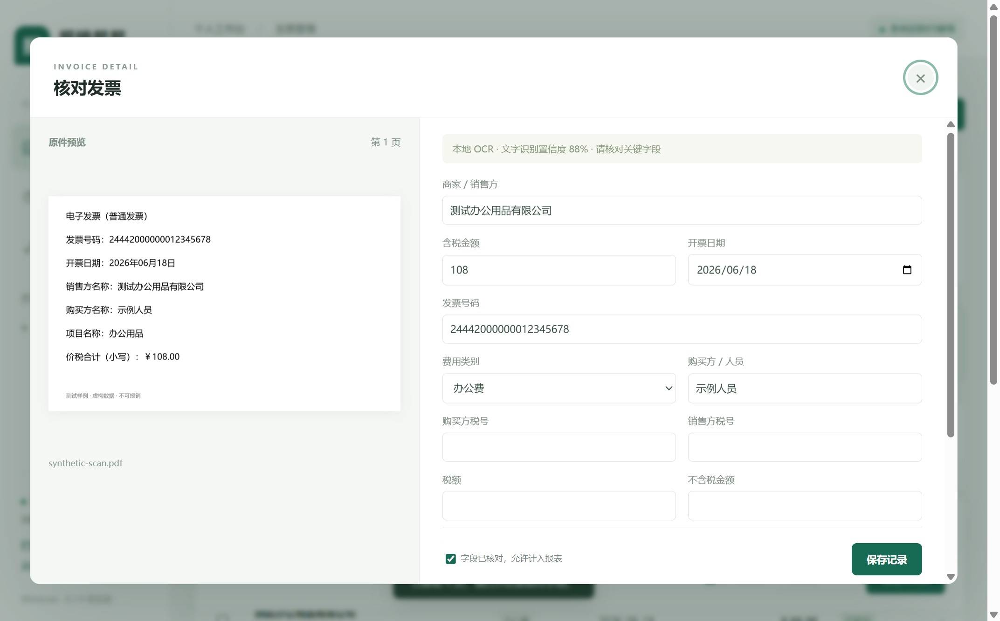

# 报销帮帮：下载与使用手册

适用版本：Windows 0.1.1 预览版。说明核对日期：2026-10-22。

报销帮帮帮助你把发票图片和 PDF 整理成发票库，再生成 Excel 报销资料。你仍需要对照原件核对字段，按单位要求提交附件和报表。

本手册主要面向直接使用 Windows 应用的人。微信小程序的体验方法在文末，开发者可另看 [桌面版开发说明](../desktop/README.md)和 [文件用途说明](FILE_GUIDE.md)。

## 一、先下载正确的文件

### 1. 电脑要求

| 项目 | 要求或说明 |
| --- | --- |
| 系统 | Windows 10 或 Windows 11，x64 |
| 查看系统类型 | Windows 设置 → 系统 → 关于 → 系统类型 |
| 软件环境 | 无需另装 Node.js、Python、微信或 OCR 工具 |
| 账号和密钥 | 无需账号、API 密钥或云环境 |
| 网络 | 打包应用识别时不需要网络，首次使用也不下载模型 |
| 存储空间 | 需容纳解压程序、导入原件和备份；使用越久，原件占用越多 |
| 查看导出的报表 | 使用支持 `.xlsx` 的 Excel、WPS 或其他兼容软件 |

当前未提供其他系统的可运行包，也未完成全部真实票据场景的识别准确率评估。

### 2. 到哪里下载

[项目 GitHub 仓库](https://github.com/smilemeiming/baoxiao-bangbang-open)的访问和发布状态以页面显示为准。先打开 [Releases 页面](https://github.com/smilemeiming/baoxiao-bangbang-open/releases)，确认目标版本下有完整 Windows ZIP 附件；如果没有程序包，请向维护者获取。

如果某个版本已经公开发布，展开该版本下的 `Assets`，选择名称类似 `BaoxiaoBangbang-版本号-win-x64.zip` 的文件。版本页面附带的 SHA-256 校验文件用于确认下载内容是否一致。

| 你拿到的文件 | 是什么 | 能否直接打开应用 |
| --- | --- | --- |
| `BaoxiaoBangbang-0.1.1-win-x64.zip` | 含运行环境和识别模型的完整 Windows 程序包 | 全部解压后可以 |
| 同名 `.zip.sha256` | 程序包的 SHA-256 校验值 | 是校验资料，不是程序 |
| `Code → Download ZIP` 下载的仓库 ZIP | 源代码 | 需要开发环境和构建 |
| Releases 的 `Source code (zip)` / `Source code (tar.gz)` | GitHub 自动生成的源代码包 | 需要构建 |
| 单独的 `BaoxiaoBangbang.exe` | 只有程序入口，缺少配套文件 | 不能作为完整包使用 |

本地构建的 0.1.1 程序包大小为 **178,687,732 字节，约 170.4 MiB**，SHA-256 为：

```text
a4ce8aab252d217cadfa7a736e5749d507c5887296677aec76ca335ba8278a4b
```

以后重新构建或升级时都应使用该版本实际生成的 `.zip.sha256` 校验值。Windows 可在文件所在目录的 PowerShell 7 中运行以下可选命令核对：

```powershell
Get-FileHash -Algorithm SHA256 -LiteralPath '.\BaoxiaoBangbang-0.1.1-win-x64.zip'
```

### 3. 解压与启动

1. 对下载好的 ZIP 点击右键，选择“全部解压”。
2. 选一个便于找到的普通文件夹，等待解压完成。
3. 进入解压后的目录，找到 `BaoxiaoBangbang.exe`，双击打开。
4. 保留这个目录中的其他文件、`resources` 和 `locales` 等文件夹。以后从这里启动，也可以为此 exe 创建桌面快捷方式。

这是免安装程序包，没有安装向导。不要在 ZIP 预览窗口中运行，也不要把 exe 单独移到桌面。当前预览版没有代码签名；如遇系统拦截，先核对包的来源与校验值并向维护者反馈，不要关闭系统保护。

## 二、认识主界面


| 位置或按钮 | 用途 |
| --- | --- |
| 左侧“全部发票” | 查看当前发票库 |
| 左侧“待核对”/“已核对” | 按人工核对状态查看 |
| 左侧费用类别 | 查看某一类别，导入后出现有记录的类别 |
| 顶部统计 | 查看全库的已核对金额、发票记录数和待核对数 |
| 右上角“＋ 导入发票” | 从电脑选择图片或 PDF |
| 中间拖放区域 | 把文件拖进来导入 |
| 搜索框 | 查商家、购买方、票号或文件名 |
| “手动新增” | 没有可用识别结果时，自己录入一条记录 |
| 表格左侧复选框 | 选择要导出原件或删除的记录 |
| “新建报销批次” | 把当前勾选的记录归入一个批次 |
| “报销批次”区域 | 选择批次，查看当前导出数量和金额，导出资料包或移除批次 |
| 底部报表区域 | 选择报表类型并导出 Excel |
| 报表“导出范围” | 选择全部记录、当前筛选或所选记录，并预览条数与金额 |
| “备份数据” | 保存包含记录及原件的备份 |
| 左下角“打开数据文件夹 ↗” | 查看应用实际保存数据的位置 |
| 左下角“从备份合并恢复…” | 从本应用的 JSON 备份恢复数据 |

顶部统计反映整个发票库，不是当前搜索结果的小计。PDF 按页生成记录，因此记录数不一定等于导入文件数。

## 三、导入你的第一张发票

1. 准备清晰的 JPG、JPEG、PNG 或 PDF。手机照片可以先传到电脑。
2. 点击“＋ 导入发票”，选取一份或多份文件；也可以拖入窗口。
3. 等待本机读取。电子 PDF 会优先提取文字；图片和没有可用文字的 PDF 页面使用内置 OCR。
4. 完成后在列表中查看新记录。即使字段识别成功，也会显示为“待核对”。
5. 打开记录进行下一节的人工核对。

**文件限制：**单文件最大 80 MB，单份 PDF 最多 500 页。Word、Excel、压缩包和 HEIC 不在当前导入格式内；请先转换为受支持的图片或 PDF。加密或损坏的 PDF 可能无法读取。

导入会将原件复制到应用的数据目录，你原来选择的文件不会被改名、移动或删除。内容完全相同的文件在已有对应记录时会跳过；同一张发票的照片和 PDF 不是同一个文件，需要人工排查重复。

如果 PDF 导入中途关闭或中断，可以重新导入同一文件。程序会跳过已经成功处理的页，继续处理缺少的页；此前识别失败、尚未人工修改的空白记录会重试。已人工编辑过的记录会保留下来。

**多页 PDF 特别说明：**每页生成一条记录。如果一张票跨两页，或一页里有多张票，记录与实际票据可能不一一对应。请对照整份原件整理，必要时删除多余记录、修改字段或手动新增，避免重复计入金额。

“需手动补全”表示识别未得到可用结果；金额显示为 0 或日期为空时，不能把它当成真实票面值。你可以手动填写，也可以先处理更清晰的文件再导入。

## 四、核对、修改与分类



1. 点击表格中的一条记录，打开“核对发票”。
2. 左边查看原件，右边检查字段。PDF 预览对应当前记录的页面。
3. 至少核实商家、含税金额和开票日期，再检查票号、购销方、税号与类别。
4. 如需归属到某个部门，填写“承担部门”和“部门负责人”；特殊情况写入备注。
5. 确认后勾选“字段已核对，允许计入报表”，点击“保存记录”。

如果相同销售方和发票号码已出现在其他记录中，列表会显示“疑似重复”。这只是提醒，不会自动删除或从报表排除。相同发票号码的扫描件、分页面记录或实际重复票据都需要你对照原件判断。

| 字段 | 怎样填写 |
| --- | --- |
| 商家/销售方 | 与票面销售方名称核对 |
| 含税金额 | 票面价税合计，填写数字；当前只支持非负金额 |
| 开票日期 | 按票面日期填写，格式为 `YYYY-MM-DD` |
| 发票号码 | 保留票面完整号码，注意易混淆的数字 |
| 费用类别 | 按实际用途选择；自动分类可以修改 |
| 购买方/人员、购买方税号 | 对照票面购买方及单位要求填写 |
| 销售方税号 | 对照票面销售方识别号 |
| 税额、不含税金额 | 按票面填写；程序不会替你完成税务审核 |
| 承担部门、部门负责人、备注 | 按本次报销要求填写 |

“查看本机读取的原始文字”可帮助你理解识别结果。OCR 的字符置信度不是字段准确率，不能据此跳过金额、税号和票号核对。程序也不会自动完成所有税额勾稽检查。

尚未核对完时可以保存为待核对。勾选完成前，需补齐有效日期、商家和金额。当前不支持负金额红字票据的完整处理流程，请单独按财务要求处理。

如果原件无法读取，也可以点击“手动新增”，录入必要字段后保存。手动记录没有关联原件，无法预览或导出原件；Excel 中有这条记录也不代表附件已经齐全。

## 五、导出 Excel 报表

1. 先在“待核对”中完成要报销记录的检查。
2. 选择导出范围：全部记录、当前筛选结果或已勾选的记录。
3. 选择一种报表类型，通常保持勾选“仅导出已核对”。
4. 查看按钮旁的预览张数和金额；确认后点击“导出 Excel”，选择保存位置。
5. 用 Excel 或 WPS 打开，检查记录、合计和单位要求的字段，再提交。

| 导出范围 | 包含哪些记录 |
| --- | --- |
| 全部记录 | 发票库所有记录；默认选项，不受搜索、侧栏类别和行勾选影响 |
| 当前筛选 | 当前搜索框和左侧状态/类别筛选后显示的记录；不要求勾选 |
| 所选记录 | 表格中已勾选的记录；筛选或搜索后先检查底部“已选择”数量 |

“仅导出已核对”和报表模式会进一步缩小上述范围。住宿与餐补模式只统计“差旅住宿费”和“餐补”类别，所以预览数可能少于所选范围中的记录总数；预览金额按这些符合条件的记录计算。若没有符合条件的记录，导出按钮会不可用。

| 报表类型 | 适用情况 |
| --- | --- |
| 汇总表 | 查看整体费用汇总与分类统计 |
| 明细表 | 逐条查看票据信息，方便逐项核对 |
| 按费用分类 | 按费用类别分工作表整理 |
| 住宿与餐补 | 组合整理住宿、餐饮类记录；不是自动计算单位餐补标准 |

**导出范围务必确认：**默认范围是“全部记录”。例如，全库有 10 条已核对记录，你搜索后只看到 2 条并勾选它们，如果不切换“当前筛选”或“所选记录”，导出明细表仍会包含那 10 条。点击导出前先查看旁边显示的张数与金额，再检查生成的 Excel。

取消“仅导出已核对”会把待核对记录也纳入导出范围。此操作只适合检查或整理，不表示记录已经审核通过。

Excel 是报表，**不会自动附带发票图片或 PDF**。归档路径指向当前电脑，别人收到 Excel 后不能通过这个路径读取你的电脑文件。需要附件时请另外导出原件。

### 创建报销批次并导出资料包

1. 在发票表格左侧勾选同一次报销需要提交的记录，点击“新建报销批次”并填写名称。
2. 在发票列表下方选择批次。资料包会使用页面当前的报表类型和“仅导出已核对”选项，旁边会显示符合条件的记录数和金额。
3. 点击“导出批次资料包”，选择 ZIP 保存位置。ZIP 包含 `报销报表.xlsx`、`原件/` 文件夹和 `导出说明.txt`。

同一份归档原件被批次中的多页记录引用时，只会放入 ZIP 一次；多页 PDF 以完整原件保留。手动录入记录会进入 Excel，但没有原件可附。资料包最大为 512 MB，较大的批次需要拆分导出。删除批次只移除归集关系，不会删除发票记录或原件。

## 六、整理原件与删除记录

### 导出规范命名的原件

1. 在表格左侧勾选需要的记录，确认“已选择”数量。
2. 点击“导出规范命名原件”。
3. 选择保存文件夹，将导出的副本与 Excel 一起按要求提交。

程序按照记录字段生成便于归档的名称，并另存副本，不改动源文件。已有同名文件不会被直接覆盖；遇到冲突请换目录或整理名称后重试。多页 PDF 导出的是**完整源 PDF**，不会按选中的记录拆成单页，选择不同页可能得到内容相同的整份文件。请检查附件份数，避免重复提交。

### 删除与撤销

1. 勾选记录，确认选择数量后点击“删除所选”。
2. 如果误删，点击“撤销上次删除”。重启后也能撤销最近一批删除。

这里只保留**最近一批**删除记录，下一次删除会替换此前可撤销的批次。它不是长期回收站。删除记录不会删除归档原件，也不会改动最初导入的源文件；因此应用占用空间可能不会立即下降。清理或迁移前先备份，不建议手动删除数据目录内的文件。

## 七、备份、换电脑与更新

### 保存备份

1. 点击右上角“备份数据”。
2. 选择保存位置，建议放在与应用数据目录不同的位置。
3. 保留生成的 JSON 文件，按日期保存多个版本。

备份包含记录和原件，不只是一个列表；因此它可能比原件总大小更大，也包含完整票据内容。这个文件不需要用记事本编辑，更不能当成普通 Excel 打开。

### 在另一台电脑恢复

1. 在新电脑解压同版本或确认兼容的 Windows 程序包。
2. 将备份 JSON 安全复制到新电脑。
3. 打开应用，点击左下角“从备份合并恢复…”，选择备份文件。
4. 等待完成，再核对记录数量、金额和原件预览。

恢复采用合并方式，会跳过已有记录和已存在的同一原件页面，保留当前库中的修改。它不能强制用旧备份覆盖现有字段。当前恢复入口限制备份文件不超过 512 MB，记录不超过 10,000 条；大型票据库迁移前应先确认备份能正常恢复。

如果启动时检测到发票库损坏，可在启动对话框直接选择备份恢复。应用先在临时目录完整验证和重建，成功后才切换数据目录，并将旧目录改名保留；备份无效或写入失败时会保留原目录，不会留下半套新发票库。

### 更换软件目录或版本

应用程序文件与发票数据分开保存。复制或发送程序 ZIP 不会自动带走自己的发票库；换电脑需要额外迁移备份。仅删除解压后的程序目录，也不等于清除用户数据。

更新前先备份并关闭旧程序，把新版本解压到新目录，保留配套文件，再启动并核对数据。当前没有自动更新功能；后续版本的数据兼容性应以对应发布说明为准。

## 八、数据保存与隐私

Windows 版的识别在本机进行，模型和 PDF 引擎都随包提供，应用不接入在线 OCR。记录及归档原件保存在当前 Windows 用户的应用数据目录，具体位置点击左下角“打开数据文件夹 ↗”查看。

| 数据或文件 | 保存在哪里/怎样流转 |
| --- | --- |
| 原来选择的票据 | 仍在原位置，不因导入或删除记录而改变 |
| 应用归档副本 | 应用数据目录内的 `documents/` |
| 发票库记录 | 应用数据目录内的 `library.json` |
| Excel、导出原件、备份 | 保存到你在对话框中选择的位置 |
| 发给同事的文件 | 只有你自行通过聊天、邮件或其他方式发送的文件 |

不要随意修改 `library.json` 或删除 `documents/`，它们共同构成发票库。备份文件不是加密保险箱；请按自己单位的数据要求保存和传递。反馈问题时不要公开真实票据、税号、备份或完整数据目录。

**微信小程序不同：**启用云识别后，所选文件会上传微信云存储，并由云函数发送到配置的 OCR 服务。当前本地删除不会自动清理云端文件或服务方保存的数据；部署者需自行设置访问权限、费用和保留策略。没有配置云环境时不会上传文件。

## 九、常见问题

| 遇到的情况 | 如何处理 |
| --- | --- |
| 下载仓库 ZIP 后找不到 exe | 下载的是源码；请获取完整 Windows 程序 ZIP，或按开发说明自行构建 |
| GitHub 页面打不开或提示不存在 | 当前仓库私有，需要访问权限；Release 程序附件尚未发布 |
| 双击提示缺少 DLL、资源或模型 | 检查是否完整解压、是否单独移动了 exe；重新获取并核对完整包 |
| Windows 阻止启动 | 核对来源和该版本校验值，向维护者反馈提示内容；不要关闭系统保护 |
| 第一次识别较慢 | 模型首次载入及扫描 PDF 逐页识别需要时间；先用一张清晰图片尝试 |
| 金额为 0、日期为空或“需手动补全” | 对照原件手动填写，必要时换清晰文件；不要直接确认默认值 |
| PDF 导入后条数比发票数多 | 当前按页生成记录，检查跨页票据和非票据页，整理后再确认 |
| 同一张票重复出现 | 只有完全相同文件内容会去重；不同照片或不同 PDF 需人工查重 |
| 看到“疑似重复” | 核对销售方和票号；提示不会自动删除记录，也不会替你排除报表 |
| “导出 Excel”提示没有记录 | 先核对并保存记录；默认不导出待核对项，同时确认所选模式有相应类别 |
| 搜索两张却导出更多 | 检查“导出范围”是否仍为默认的“全部记录”；详见第五节 |
| 同事收到报表但看不到发票 | Excel 不包含原件，请另行导出并发送所需附件 |
| 重装或移走软件后数据还在 | 数据保存在应用用户数据目录；先备份再考虑清理 |
| 恢复后没有覆盖修改 | 合并恢复会跳过已有记录，这是当前行为；不是覆盖还原 |
| 需要多人同步、审批或查验真伪 | 当前未提供这些功能，请按单位现有流程处理 |

反馈时说明 Windows 版本、应用版本、操作步骤、文件类型和大小、提示内容。截图和复现文件请使用虚构或充分脱敏的数据。获得仓库权限后可使用 [GitHub Issues](https://github.com/smilemeiming/baoxiao-bangbang-open/issues)；无法访问时请通过获取程序的渠道联系维护者。

## 十、如果你想体验微信小程序

仓库提供的是小程序源码，不代表已上线可搜索使用的小程序。下载源码后需要微信开发者工具；真实 OCR 还需自己的 AppID、云环境和识别服务。

1. 安装 Node.js 22.16 或更新版本及微信开发者工具。
2. 在整个项目根目录依次执行 `npm ci`、`npm run setup`、`npm run verify`。
3. 在微信开发者工具导入根目录，按工具要求配置 AppID。
4. 进入“总览”页面，点击“载入虚构示例数据”。
5. 在“发票库”体验编辑，在“报表”体验导出。示例会加入当前库，没有真实原件。
6. 需要识别真实票据时，按 [部署指南](DEPLOYMENT.md)和 [云函数说明](../cloudfunctions/invoice-ocr/README.md)配置服务。

小程序当前拒绝非航空行程单、住宿结算单、订单等辅助单据，允许航空运输电子客票行程单。历史打车配对代码仍在，但不代表支持新增打车行程单导入。不要把这些小程序规则当作 Windows 版已经完成的票据有效性审核。

## 继续阅读

[回到项目介绍](../README.md) · [每个文件的用途](FILE_GUIDE.md) · [Windows 源码构建](../desktop/README.md) · [许可证](../LICENSE)
